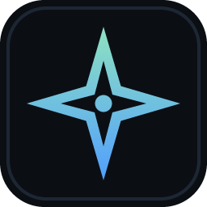
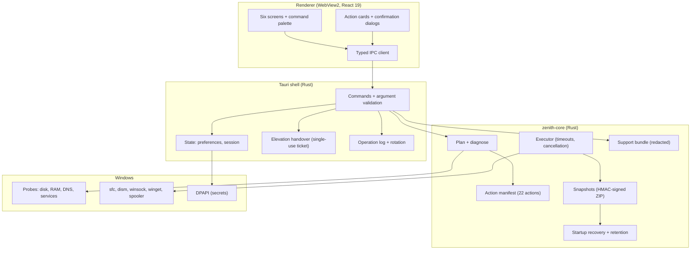

<div align="center">

<a href="https://vellium.dev" target="_blank" rel="noopener noreferrer">
  
</a>

<br /><br />

# Zenith - Free & Open-Source Windows System Diagnostic & Repair Utility

<em>Measures what is actually wrong, explains it plainly, repairs only what you approve</em>

<strong>Free &amp; Open-Source (MIT) by <a href="https://vellium.dev">Vellium</a></strong>

</div>

---

<div align="center">

[](#english-version)
&nbsp;&nbsp;&nbsp;&nbsp;
[](#t%C3%BCrk%C3%A7e-s%C3%BCr%C3%BCm)

</div>

---

<a id="english-version"></a>
# English Version

<div align="center">
  
  <h3>Zenith - A Local-First Windows System Doctor That Tells the Truth</h3>
  <p><em>22 repair actions &bull; Four reversibility tiers &bull; Snapshot rollback &bull; Evidence over animation &bull; No telemetry</em></p>
  <p><strong>Free &amp; Open-Source (MIT) by <a href="https://vellium.dev">Vellium</a></strong></p>
</div>

<br>

##  Project Overview

**Zenith (`v1.0.0`)** is a **free, open-source (`MIT`), local-first Windows system diagnostic and repair utility** built by **Vellium** for power users and for IT departments that ban consumer "cleaners". It is written as a **Tauri 2** desktop application: a **Rust core** (`crates/zenith-core`) that owns every measurement, every mutation and every rollback, and a **React 19 + TypeScript** interface that only renders what the core reports.

Most Windows maintenance knowledge is trapped in three places: tribal IT memory, ad-hoc cleanup scripts of unknown provenance, and a dozen Microsoft tools (`sfc`, `dism`, `winsock reset`, `winget`, `Spooler`, `ipconfig`) that each have their own failure semantics. Zenith collects those operations into **22 named actions** across **4 categories**, and surrounds each one with three rules the application enforces rather than promises:

| Law | What it means in the product |
| :--- | :--- |
| **Truth over comfort** | Every action declares one of **four reversibility tiers**. No action claims full rollback, and an irreversible one says so before the click. |
| **Evidence over animation** | Every number on screen is measured from the OS, with units and a source. When a value cannot be measured the UI says **"not measured"** instead of drawing a zero. |
| **Exit over lock-in** | Any action can be exported as a readable PowerShell script and run on a machine that has never had Zenith installed. |

> **Documentation:** the architecture, threat model, test plan and release record are indexed in [`docs/README.md`](docs/README.md).

---

##  Key Features

###  A Catalogue, Not a Button Pile

Every action is declared once in a Rust manifest and generated into the renderer, so the catalogue cannot drift from the code that runs it.

- **Cleanup (5):** temp cache, Recycle Bin, old screenshots, `winget` upgrade sweep, Windows Update scan.
- **Network (5):** DNS cache flush, Winsock stack reset, stuck proxy/VPN clear, NTP time sync, sysadmin info copy.
- **Recovery (8):** DISM component-store repair, SFC system scan, Explorer restart, icon cache rebuild, Bluetooth service restart, print spooler reset, GPU driver reset, controlled reboot.
- **Developer & Office (4):** dev port unlock, hung Office process close, Teams/Outlook cache clear, WSL/Docker memory reclaim.
- Each action declares its **risk** (`safe`, `moderate`, `destructive`), its **reversibility tier**, whether it **requires administrator**, whether it is **abortable**, whether it is **read-only**, and its **timeout**.

###  Four Tiers, No Promises

| Tier | Guarantee |
| :--- | :--- |
| `fully_reversible` | A snapshot is taken first and restoring it returns the machine to the previous state. |
| `partially_reversible` | Some of the change can be undone; the action states which part cannot. |
| `compensating_recovery` | The change cannot be undone, but a corrective action exists and is named. |
| `irreversible` | Nothing is recoverable. The confirmation dialog says so before the click. |

###  Snapshots and Undo History

- Before a mutating action runs, the core records the affected paths, writes a **HMAC-signed ZIP archive**, reads it back to verify it, and only then proceeds.
- **Undo history** lists every snapshot with its size, age and status, and rolls one back with a single confirmation.
- Purging snapshots is bounded by a retention policy, and a purge that cannot clear a directory **reports the directory** instead of claiming a clean wipe.

###  Measurement, Not Theatre

- One health score, computed from measured inputs, with the formula published in the application.
- Four KPI cards (temporary files, DNS latency, RAM, issue count). A metric that has not been measured renders as **not measured** (`-`), never as `0`.
- Six diagnostic probes run on demand and produce plain-language findings with a remediation for each.

###  Script Export and an In-App Console

- **Script export** renders any action as a readable PowerShell script, so the operation can be reviewed, diffed and run without Zenith.
- **In-app console** streams the operation log with redaction applied, so a failed repair can be diagnosed where it happened.

###  Elevation That Holds

- Actions that need administrator rights are marked as such, and running one from a standard session hands off through a **single-use, nonce-bound ticket** with a PID check and an expiry.
- The handover **saves preferences before the elevated process starts**, so the new window opens in the theme and language the user chose.
- The elevated instance reads the ticket once, deletes it before validating content, and refuses a ticket whose nonce, PID or expiry does not match.

###  Turkish and English, Off-White, True Black and Spatial Glass

- **English and Turkish** catalogues with structural parity enforced by a gate, and ICU-style plural handling per locale.
- **Three themes** (`off-white`, `true-black`, `spatial-glass`) that share one geometry, one type scale and one motion vocabulary; colour is the only thing a theme changes, and it lives in one token file.
- **Accessibility** is measured, not asserted: focus trap, keyboard navigation across the card grid, accessible names computed with the browser's own algorithm, and a contrast gate over 75 pairs across the three themes.

###  306 Rust Tests, 166 Frontend Tests, 26 Gates

- **306 Rust tests** and **166 Vitest tests** across 12 files.
- A **28-step release gate** (`npm run verify`) that stops at the first failure, from locale parity to FFI safety to a self-contained-bundle proof of the shipped binary.
- A **file-by-file pre-deployment audit** with a verdict for every production source file, and a fix record for every change it produced: [`10-03`](docs/10-audit/10-03-pre-deployment-qa.md), [`10-04`](docs/10-audit/10-04-release-fix-record.md).

---

##  Tech Stack

<div align="center">


</div>

### Runtime and UI

- **Tauri 2** with a **Rust 1.90 (edition 2024)** core and a **WebView2** renderer. The release build enables the `custom-protocol` feature, which embeds the built renderer instead of pointing at a dev server.
- **React 19 + TypeScript 5.9**, bundled by **Vite 7**. No CDN at runtime: CSP is `default-src 'self'`, and the UI typeface (Inter) and monospace (JetBrains Mono) are self-hosted.
- **Hand-written inline SVG icons**, one module, `aria-hidden`, drawn in `currentColor`. There is no icon font and no fallback glyph.

### Core and Data

- **`crates/zenith-core`** owns measurement, planning, execution, snapshots, retention and recovery. It is usable without the GUI and is exercised by its own test suite.
- **SQLite** (`rusqlite`, bundled) for the operation ledger and snapshot metadata, with WAL mode.
- **HMAC-SHA256** over snapshot archives, verified by reading the archive back before any mutation proceeds.
- **Windows DPAPI** for secrets at rest, and a **Win32 FFI layer** where every `unsafe` block and every `unsafe impl` carries its own `SAFETY` comment that a gate verifies (106 blocks + 2 impls, 110 comments).

### Build, Test and Release

- **`npm run verify`**: a **28-step** chain that runs the frontend gate, the Rust tests, the production build and a bundle proof, in that order.
- **`cargo test --workspace`**: 306 tests across the core and the shell.
- **`npm run test`**: 166 Vitest tests across 12 files.
- **GitHub Actions**: CI on `main` and `development`, running the same gate the release depends on.

---

##  Project Structure

```tree
Zenith/
├── .github/workflows/            # CI: the same 28-step gate, on Windows
├── crates/zenith-core/           # The engine: measurement, planning, execution, snapshots
│   ├── src/adapters/             # OS seams: probes, cleanup, child processes, DPAPI, privilege
│   ├── src/engine/               # executor, pipeline, db, purge, recovery, health, support
│   ├── src/bin/zenith-audit.rs   # Zero-stub and manifest audit tool
│   ├── examples/dump_manifest.rs # Generates the renderer catalogue; drift test enforces parity
│   └── tests/catalog_in_sync.rs  # Fails if the generated catalogue drifts from the manifest
├── src-tauri/                    # The shell: commands, state, logging, elevation handover
│   └── icons/                    # Application icons (32, 128, 128@2x, .ico)
├── src/                          # The renderer
│   ├── ui/                       # Shell, sidebar, KPI strip, cards, dialogs, six screens
│   ├── bridge/                   # Typed IPC client and the simulator used by tests
│   ├── state/                    # One reducer, one store
│   ├── i18n/                     # en/tr catalogues, ICU subset, locale-aware formatting
│   ├── shared/                   # The single "not measured" constant
│   └── styles/                   # Token layer, app styles
├── docs/                         # 30 documents: PRD, SRS, SAD, threat model, test plan, audit
├── evidence/                     # Captured gate output and ten screenshots, with a ledger
├── resources/                    # Pinned build assets: manifest, fetch.mjs, hashes
│   └── manifest.json             # SHA-256 for every vendored asset
├── scripts/                      # Gate scripts, each a single-purpose Node script
├── tools/cargo-deny/             # Vendored dependency-policy binary
├── Cargo.toml                    # Workspace: MSRV 1.90, edition 2024
├── deny.toml                     # Advisories, licences, bans, sources
└── package.json                  # Scripts, and the `verify` chain
```

---

##  Architecture and Security Boundaries



**Trust boundaries.** The renderer has no filesystem or process access of its own: it calls named commands, and the shell validates arguments before they reach the core. The core decides what may be mutated, takes the snapshot, and honours the timeout. An action that needs elevation crosses into a second process through a ticket that is single-use, nonce-bound, PID-bound and time-bound.

**Why the core is separate.** Every rule that matters (a snapshot is verified before a mutation, an unmeasurable value is reported as unknown, a purge that fails says which directory it could not clear) is testable without a window. The shell and the renderer are then free to be ordinary UI code.

---

##  Installation and Usage

### For an end user (installer)

1. Download `Zenith_1.0.0_x64-setup.exe` from the releases page.
2. Run it. The installer is per-machine and asks for the elevation Windows requires for a system utility.
3. Launch **Zenith** from the Start menu.

**Uninstall:** Windows Settings -> Apps -> Zenith -> Uninstall. The uninstaller offers to keep or remove your local data (`%LOCALAPPDATA%\Vellium\Zenith`).

### From source

```bash
git clone https://github.com/emirtdede/zenith.git
cd zenith

# Node 24.22.3 and Rust 1.90 (MSVC) are pinned; see docs/08-delivery/08-01-build-prerequisites.md
npm ci
node resources/fetch.mjs     # fetch and hash-verify the pinned build assets

# Development
npm run dev                  # Vite on 1420, Tauri dev window
npm run tauri dev

# The release gate: 27 steps, stops at the first failure
npm run verify

# Desktop end-to-end (needs tauri-driver and msedgedriver)
npm run e2e -- --app target/release/zenith.exe --driver "$env:TEMP\zenith-e2e\msedgedriver.exe"

# Signed installer for v1.0.0
npm run tauri build
```

### Why `resources/fetch.mjs` exists

`resources/` is the air-gap promise: a clean Windows machine can rebuild without reaching the internet. The set is 307 MB, and the WebView2 evergreen offline installer alone is 215 MB, past GitHub's per-file limit. The **pins** are committed (`resources/manifest.json`: SHA-256, byte count and source for every asset); the **bytes** are fetched, and `fetch.mjs` refuses any file whose hash or size does not match the pin.

---

##  Documentation

The full set is indexed in [`docs/README.md`](docs/README.md). The documents a reader usually wants first:

| Document | What it answers |
| :--- | :--- |
| [`01-01` PRD](docs/01-product/01-01-prd.md) | The problem, the three product laws, and who this is for |
| [`03-01` SAD](docs/03-architecture/03-01-sad.md) | How the core, the shell and the renderer divide responsibility |
| [`03-05` Actions Manifest](docs/03-architecture/03-05-actions-manifest.md) | The contract behind every one of the 22 actions |
| [`03-06` Win32 FFI Safety](docs/03-architecture/03-06-win32-ffi-safety.md) | The rule every `unsafe` block obeys |
| [`04-01` Threat Model](docs/04-security/04-01-threat-model.md) | Assets, adversaries, and what fails closed |
| [`07-01` Test Plan](docs/07-quality/07-01-test-plan.md) | Seams, matrix, and the 28-step gate |
| [`10-02` Deficiency Register](docs/10-audit/10-02-deficiency-register.md) | Every defect, its owner and its closure evidence |
| [`10-03` Pre-Deployment QA](docs/10-audit/10-03-pre-deployment-qa.md) | A verdict for every production source file |

**Honest status.** `v1.0.0` is built, gated and audited, and nine register rows remain open: an EV code-signing certificate (owner purchase), the T-WIN virtual-machine matrix, native-speaker review of the Turkish catalogue, the ARM64 toolchain, a signed updater manifest, screen-reader verification on real hosts, the `enterprise-telemetry` tier (deliberately out of scope), and one transitive `chrono` dependency. None of them is an open finding of the audit; each is blocked on an owner asset or external infrastructure, and `10-03` section 7 states each one plainly.

---

##  License and Publisher

**Free and open-source software (`MIT`).** Copyright 2026 **Vellium Teknoloji Anonim Sirketi**.

Licensed under the MIT License: you may use, study, modify and redistribute it for personal, community or commercial use. See [`LICENSE`](LICENSE) for the exact terms.

- **Publisher:** Vellium Teknoloji Anonim Sirketi
- **Website:** [vellium.dev](https://vellium.dev)
- **Security disclosure:** [security@vellium.dev](mailto:security@vellium.dev)
- **Support:** [support@vellium.dev](mailto:support@vellium.dev)

---

<a id="türkçe-sürüm"></a>
# Türkçe Sürüm

<div align="center">
  
  <h3>Zenith - Windows için Gerçeği Söyleyen Yerel Sistem Doktoru</h3>
  <p><em>22 onarım eylemi &bull; Dört geri alınabilirlik kademesi &bull; Anlık görüntüyle geri alma &bull; Telemetri yok</em></p>
  <p><strong><a href="https://vellium.dev">Vellium</a> tarafından ücretsiz ve açık kaynak (MIT)</strong></p>
</div>

<br>

##  Projeye Genel Bakış

**Zenith (`v1.0.0`)**, güç kullanıcıları ve tüketici "temizleyici" yazılımlarını yasaklayan BT departmanları için geliştirilmiş, **ücretsiz, açık kaynak (`MIT`), yerel öncelikli bir Windows sistem tanılama ve onarım aracıdır**. **Tauri 2** masaüstü uygulaması olarak yazılmıştır: her ölçümün, her değişikliğin ve her geri almanın sahibi **Rust çekirdeği** (`crates/zenith-core`), arayüz ise yalnızca çekirdeğin bildirdiğini gösteren **React 19 + TypeScript** katmanıdır.

Windows bakım bilgisi üç yerde sıkışmış durumdadır: kurumsal hafıza, kaynağı bilinmeyen temizlik betikleri ve her biri farklı hata semantiğine sahip bir düzine Microsoft aracı (`sfc`, `dism`, `winsock reset`, `winget`, `Spooler`, `ipconfig`). Zenith bu işlemleri **4 kategoride 22 adlandırılmış eylemde** toplar ve her birini ürünün vaat ettiği değil, uyguladığı üç kuralla çevreler:

| Kural | Üründeki karşılığı |
| :--- | :--- |
| **Rahatlık değil gerçek** | Her eylem **dört geri alınabilirlik kademesinden** birini bildirir. Hiçbir eylem tam geri alma iddia etmez; geri alınamaz olan bunu tıklamadan önce söyler. |
| **Animasyon değil kanıt** | Ekrandaki her sayı işletim sisteminden ölçülür; birimi ve kaynağı vardır. Ölçülemeyen değer sıfır olarak çizilmez, **"ölçülmedi"** olarak yazılır. |
| **Kilitleme değil çıkış** | Herhangi bir eylem okunabilir bir PowerShell betiği olarak dışa aktarılabilir ve Zenith kurulu olmayan bir makinede çalıştırılabilir. |

> **Belgeler:** mimari, tehdit modeli, test planı ve sürüm kaydı [`docs/README.md`](docs/README.md) içinde dizinlenmiştir.

---

##  Öne Çıkan Özellikler

###  Buton Yığını Değil, Katalog

Her eylem Rust tarafında tek bir manifestte tanımlanır ve arayüze üretilir; katalog, onu çalıştıran koddan ayrışamaz.

- **Temizlik (5):** geçici dosyalar, Geri Dönüşüm Kutusu, eski ekran görüntüleri, `winget` güncelleme taraması, Windows Update taraması.
- **Ağ (5):** DNS önbelleği, Winsock yığını, takılı proxy/VPN, NTP saat eşitleme, sistem bilgisi kopyalama.
- **Kurtarma (8):** DISM bileşen deposu, SFC taraması, Explorer yeniden başlatma, ikon önbelleği, Bluetooth servisi, yazdırma biriktiricisi, GPU sürücüsü, kontrollü yeniden başlatma.
- **Geliştirici ve Office (4):** geliştirici portları, takılı Office süreci, Teams/Outlook önbelleği, WSL/Docker bellek geri kazanımı.
- Her eylem **riskini** (`safe`, `moderate`, `destructive`), **geri alınabilirlik kademesini**, **yönetici gerekip gerekmediğini**, **iptal edilebilirliğini**, **salt okunur olup olmadığını** ve **zaman aşımını** bildirir.

###  Dört Kademe, Vaat Yok

| Kademe | Garanti |
| :--- | :--- |
| `fully_reversible` | Önce anlık görüntü alınır; geri yükleme makineyi önceki duruma döndürür. |
| `partially_reversible` | Değişikliğin bir kısmı geri alınabilir; hangi kısmın alınamadığı söylenir. |
| `compensating_recovery` | Değişiklik geri alınamaz, ancak adı verilen bir düzeltici eylem vardır. |
| `irreversible` | Hiçbir şey kurtarılamaz. Onay penceresi bunu tıklamadan önce söyler. |

###  Anlık Görüntüler ve Geri Alma Geçmişi

- Değişiklik yapan bir eylem çalışmadan önce çekirdek etkilenen yolları kaydeder, **HMAC ile imzalanmış bir ZIP arşivi** yazar, arşivi okuyarak doğrular ve ancak ondan sonra devam eder.
- **Geri alma geçmişi** her anlık görüntüyü boyutu, yaşı ve durumuyla listeler ve tek onayla geri yükler.
- Anlık görüntülerin temizlenmesi bir saklama politikasıyla sınırlıdır ve bir dizini temizleyemeyen temizlik, temiz bir silme iddia etmek yerine **o dizini bildirir**.

###  Tiyatro Değil Ölçüm

- Ölçülen girdilerden hesaplanan tek bir sağlık puanı; formülü uygulamada yayımlanır.
- Dört KPI kartı (geçici dosyalar, DNS gecikmesi, RAM, sorun sayısı). Ölçülmemiş bir metrik **ölçülmedi** (`-`) olarak görünür, asla `0` olarak değil.
- Altı tanılama sondası isteğe bağlı çalışır ve her biri için sade dille bir bulgu ve bir düzeltme üretir.

###  Betik Dışa Aktarma ve Uygulama İçi Konsol

- **Betik dışa aktarma** herhangi bir eylemi okunabilir bir PowerShell betiği olarak üretir; işlem incelenebilir, karşılaştırılabilir ve Zenith olmadan çalıştırılabilir.
- **Uygulama içi konsol** işlem günlüğünü maskeleme uygulanmış olarak akıtır; başarısız bir onarım tam da olduğu yerde incelenebilir.

###  Tutarlı Yönetici Yükseltmesi

- Yönetici hakları gerektiren eylemler işaretlidir ve standart bir oturumdan çalıştırıldığında **tek kullanımlık, nonce bağlı bir bilet** ile devredilir; PID ve süre denetlenir.
- Devir, yükseltilmiş süreç başlamadan **tercihleri kaydeder**, böylece yeni pencere kullanıcının seçtiği tema ve dille açılır.
- Yükseltilmiş örnek bileti bir kez okur, içeriği doğrulamadan önce siler ve nonce, PID veya süresi uyuşmayan bileti reddeder.

###  Türkçe ve İngilizce, Üç Tema

- **Türkçe ve İngilizce** kataloglar; yapısal parite bir kapı tarafından zorunlu tutulur ve çoğullar dile göre işlenir.
- **Üç tema** (`off-white`, `true-black`, `spatial-glass`) tek geometriyi, tek tip ölçeğini ve tek hareket sözlüğünü paylaşır; temanın değiştirdiği tek şey renktir ve renk tek bir token dosyasında yaşar.
- **Erişilebilirlik** iddia değil ölçümdür: odak tuzağı, kart ızgarasında klavye gezinmesi, tarayıcının kendi algoritmasıyla hesaplanan erişilebilir adlar ve üç temada 75 kontrast çiftini denetleyen bir kapı.

###  306 Rust Testi, 166 Arayüz Testi, 26 Kapı

- **306 Rust testi** ve 12 dosyada **166 Vitest testi**.
- İlk hatada duran **26 adımlık sürüm kapısı** (`npm run verify`): dil paritesinden FFI güvenliğine, oradan gönderilen ikilinin kendi kendine yeterli olduğunun kanıtına kadar.
- Her üretim kaynak dosyası için bir hüküm içeren **dosya dosya yayın öncesi denetim** ve ürettiği her değişikliğin kaydı: [`10-03`](docs/10-audit/10-03-pre-deployment-qa.md), [`10-04`](docs/10-audit/10-04-release-fix-record.md).

---

##  Teknoloji Yığını

<div align="center">


</div>

### Çalışma Zamanı ve Arayüz

- **Tauri 2**, **Rust 1.90 (edition 2024)** çekirdeği ve **WebView2** arayüzü. Yayın derlemesi `custom-protocol` özelliğini açar; böylece derlenmiş arayüz ikilinin içine gömülür, bir geliştirme sunucusuna işaret etmez.
- **React 19 + TypeScript 5.9**, **Vite 7** ile paketlenir. Çalışma anında CDN yoktur: CSP `default-src 'self'` ve arayüz yazı tipi (Inter) ile eşaralıklı yazı tipi (JetBrains Mono) kendi sunulur.
- **Elle yazılmış satır içi SVG ikonlar**, tek modül, `aria-hidden`, `currentColor` ile çizilir. İkon fontu ve yedek glif yoktur.

### Çekirdek ve Veri

- **`crates/zenith-core`** ölçümün, planlamanın, yürütmenin, anlık görüntülerin, saklamanın ve kurtarmanın sahibidir. Arayüz olmadan kullanılabilir ve kendi test paketiyle sınanır.
- **SQLite** (`rusqlite`, gömülü) işlem defteri ve anlık görüntü üst verisi için, WAL modunda.
- **HMAC-SHA256** anlık görüntü arşivleri üzerinde; herhangi bir değişiklik ilerlemeden önce arşiv okunarak doğrulanır.
- **Windows DPAPI** durağan sırlar için, ve her `unsafe` bloğunun ve her `unsafe impl`in kendi `SAFETY` yorumunu taşıdığı, bir kapının denetlediği bir **Win32 FFI katmanı** (106 blok + 2 impl, 110 yorum).

### Derleme, Test ve Sürüm

- **`npm run verify`**: ön yüz kapısını, Rust testlerini, üretim derlemesini ve paket kanıtını bu sırayla çalıştıran **26 adımlık** zincir.
- **`cargo test --workspace`**: çekirdek ve kabuk genelinde 306 test.
- **`npm run test`**: 12 dosyada 166 Vitest testi.
- **GitHub Actions**: `main` ve `development` dallarında, sürümün dayandığı aynı kapıyı çalıştıran CI.

---

##  Proje Yapısı

```tree
Zenith/
├── .github/workflows/            # CI: aynı 26 adımlık kapı, Windows üzerinde
├── crates/zenith-core/           # Motor: ölçüm, planlama, yürütme, anlık görüntüler
│   ├── src/adapters/             # İşletim sistemi dikişleri: sondalar, temizlik, süreçler, DPAPI
│   ├── src/engine/               # executor, pipeline, db, purge, recovery, health, support
│   ├── src/bin/zenith-audit.rs   # Sıfır sahte kod ve manifest denetim aracı
│   ├── examples/dump_manifest.rs # Arayüz kataloğunu üretir; kayma testi pariteyi zorunlu tutar
│   └── tests/catalog_in_sync.rs  # Üretilen katalog manifestten kayarsa başarısız olur
├── src-tauri/                    # Kabuk: komutlar, durum, günlük, yükseltme devri
│   └── icons/                    # Uygulama ikonları (32, 128, 128@2x, .ico)
├── src/                          # Arayüz
│   ├── ui/                       # Kabuk, kenar çubuğu, KPI şeridi, kartlar, pencereler, altı ekran
│   ├── bridge/                   # Tipli IPC istemcisi ve testlerin kullandığı simülatör
│   ├── state/                    # Tek reducer, tek store
│   ├── i18n/                     # en/tr katalogları, ICU alt kümesi, dile duyarlı biçimlendirme
│   ├── shared/                   # Tek "ölçülmedi" sabiti
│   └── styles/                   # Token katmanı, uygulama stilleri
├── docs/                         # 30 belge: PRD, SRS, SAD, tehdit modeli, test planı, denetim
├── evidence/                     # Yakalanmış kapı çıktısı ve on ekran görüntüsü, defterli
├── resources/                    # Sabitlenmiş derleme varlıkları: manifest, fetch.mjs, özetler
│   └── manifest.json             # Her varlık için SHA-256
├── scripts/                      # Kapı betikleri, her biri tek amaçlı bir Node betiği
├── tools/cargo-deny/             # Gömülü bağımlılık politikası ikilisi
├── Cargo.toml                    # Çalışma alanı: MSRV 1.90, edition 2024
├── deny.toml                     # Uyarılar, lisanslar, yasaklar, kaynaklar
└── package.json                  # Betikler ve `verify` zinciri
```

---

##  Kurulum ve Kullanım

### Son kullanıcı için (kurulum dosyasından)

1. Sürümler sayfasından `Zenith_1.0.0_x64-setup.exe` dosyasını indirin.
2. Çalıştırın. Kurulum makine genelidir ve bir sistem aracı için Windows'un istediği yükseltmeyi talep eder.
3. Başlat menüsünden **Zenith** uygulamasını açın.

**Kaldırma:** Windows Ayarlar -> Uygulamalar -> Zenith -> Kaldır. Kaldırıcı, yerel verilerinizi (`%LOCALAPPDATA%\Vellium\Zenith`) koruma veya kaldırma seçeneği sunar.

### Kaynaktan

```bash
git clone https://github.com/emirtdede/zenith.git
cd zenith

# Node 24.22.3 ve Rust 1.90 (MSVC) sabitlenmiştir; bkz. docs/08-delivery/08-01-build-prerequisites.md
npm ci
node resources/fetch.mjs     # sabitlenmiş derleme varlıklarını indir ve özetini doğrula

# Geliştirme
npm run dev                  # 1420 üzerinde Vite ve Tauri geliştirme penceresi
npm run tauri dev

# Sürüm kapısı: 26 adım, ilk hatada durur
npm run verify

# Masaüstü uçtan uca testi (tauri-driver ve msedgedriver gerekir)
npm run e2e -- --app target/release/zenith.exe --driver "$env:TEMP\zenith-e2e\msedgedriver.exe"

# v1.0.0 için imzalı kurulum dosyası
npm run tauri build
```

### `resources/fetch.mjs` neden var

`resources/` hava boşluğu vaadidir: temiz bir Windows makinesi internete çıkmadan derleyebilir. Kümenin tamamı 307 MB'tır ve WebView2 çevrimdışı kurulum paketi tek başına 215 MB olup GitHub'ın dosya başına sınırını aşar. **Sabitlemeler** depoda saklanır (`resources/manifest.json`: her varlık için SHA-256, bayt sayısı ve kaynak); **baytlar** indirilir ve `fetch.mjs` özeti veya boyutu uyuşmayan hiçbir dosyayı kabul etmez.

---

##  Belgeler

Belgelerin tamamı [`docs/README.md`](docs/README.md) içinde dizinlenmiştir. Okuyucunun genellikle ilk aradığı belgeler:

| Belge | Neyi yanıtlar |
| :--- | :--- |
| [`01-01` PRD](docs/01-product/01-01-prd.md) | Sorun, üç ürün kuralı ve hedef kullanıcı |
| [`03-01` SAD](docs/03-architecture/03-01-sad.md) | Çekirdek, kabuk ve arayüzün sorumluluğu nasıl bölüştüğü |
| [`03-05` Eylem Manifesti](docs/03-architecture/03-05-actions-manifest.md) | 22 eylemin arkasındaki sözleşme |
| [`03-06` Win32 FFI Güvenliği](docs/03-architecture/03-06-win32-ffi-safety.md) | Her `unsafe` bloğun uyduğu kural |
| [`04-01` Tehdit Modeli](docs/04-security/04-01-threat-model.md) | Varlıklar, düşmanlar ve kapalı yönde başarısız olan her yol |
| [`07-01` Test Planı](docs/07-quality/07-01-test-plan.md) | Dikişler, matris ve 26 adımlık kapı |
| [`10-02` Kusur Kaydı](docs/10-audit/10-02-deficiency-register.md) | Her kusur, sahibi ve kapanış kanıtı |
| [`10-03` Yayın Öncesi Denetim](docs/10-audit/10-03-pre-deployment-qa.md) | Her üretim kaynak dosyası için bir hüküm |

**Dürüst durum.** `v1.0.0` derlenmiş, kapılardan geçmiş ve denetlenmiştir; dokuz kayıt satırı açıktır: EV kod imzalama sertifikası (sahibin satın alması), T-WIN sanal makine matrisi, Türkçe kataloğun ana dili konuşan biri tarafından incelenmesi, ARM64 araç zinciri, imzalı güncelleme manifesti, gerçek makinelerde ekran okuyucu doğrulaması, `enterprise-telemetry` katmanı (bilinçli olarak kapsam dışı) ve bir dolaylı `chrono` bağımlılığı. Bunların hiçbiri denetimin açık bir bulgusu değildir; her biri bir sahip varlığına veya dış altyapıya bağlıdır ve `10-03` bölüm 7 her birini açıkça belirtir.

---

##  Lisans ve Yayıncı

**Ücretsiz ve açık kaynak yazılım (`MIT`).** Copyright 2026 **Vellium Teknoloji Anonim Sirketi**.

MIT Lisansı kapsamında lisanslanmıştır: kişisel, topluluk veya kurumsal ortamlarda ücretsiz olarak kullanabilir, inceleyebilir, değiştirebilir ve dağıtabilirsiniz. Tam koşullar için [`LICENSE`](LICENSE) dosyasına bakın.

- **Yayıncı:** Vellium Teknoloji Anonim Sirketi
- **Web sitesi:** [vellium.dev](https://vellium.dev)
- **Güvenlik bildirimi:** [security@vellium.dev](mailto:security@vellium.dev)
- **Destek:** [support@vellium.dev](mailto:support@vellium.dev)
