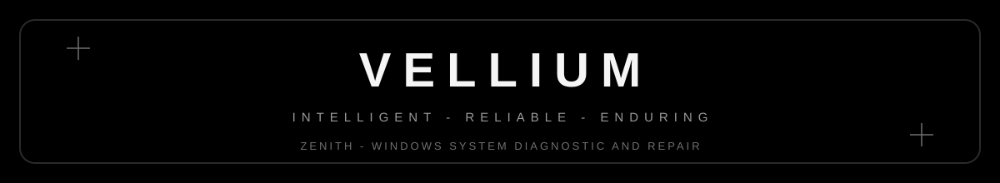
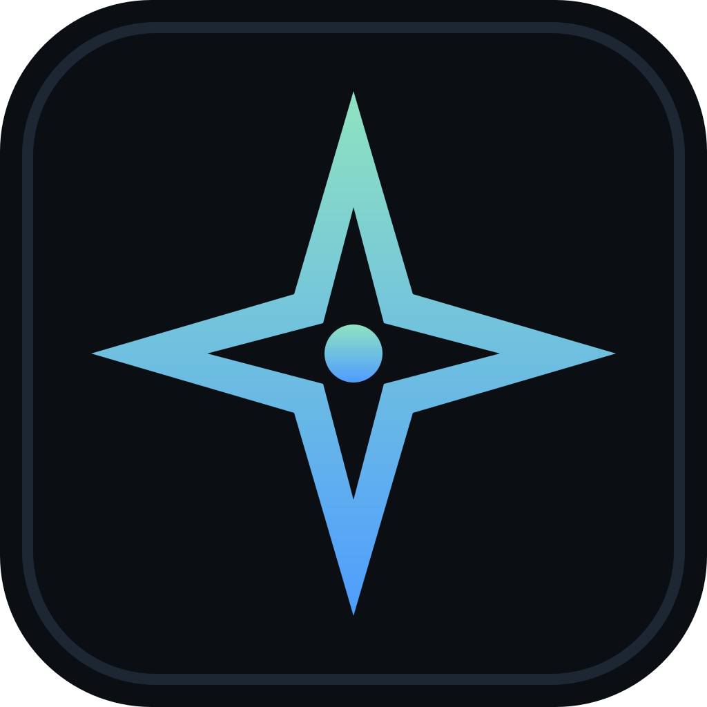
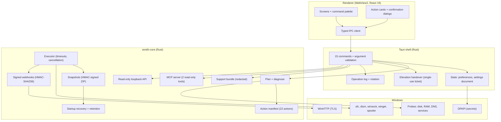

<div align="center">

<a href="https://vellium.dev" target="_blank" rel="noopener noreferrer">
  
</a>

<br /><br />

#  Zenith - Free & Open-Source Windows System Diagnostic & Repair

</div>

---

<div align="center">

[](#english-version)
&nbsp;&nbsp;&nbsp;&nbsp;
[](#turkish-version)

</div>

---

<div align="center">

[](https://github.com/emirtdede/zenith/actions/workflows/verify.yml)


</div>

---

<a id="english-version"></a>
# English Version

<div align="center">
  
  <h3>Zenith - A Local-First Windows System Doctor That Tells the Truth</h3>
  <p><em>22 Repair Actions, Four Reversibility Tiers, HMAC-Signed Snapshots, a Built-in MCP Server, a Terminal CLI, 28 Theme Palettes, 73 Languages, and a Read-Only Local API</em></p>
  <p><strong>Free &amp; Open-Source (MIT) by <a href="https://vellium.dev">Vellium</a></strong></p>
</div>

<br>

##  Project Overview

**Zenith (`v1.0.0`)** is a **free, open-source (`MIT`), local-first Windows system diagnostic and repair utility** built by **Vellium** for power users and for IT departments that ban consumer "cleaners". It is a **Tauri 2** desktop application: a **Rust core** (`crates/zenith-core`) owns every measurement, every mutation and every rollback, and a **React 19 + TypeScript** interface only renders what the core reports.

Most Windows maintenance knowledge is trapped in three places: tribal IT memory, ad-hoc cleanup scripts of unknown provenance, and a dozen Microsoft tools (`sfc`, `dism`, `winsock reset`, `winget`, `Spooler`, `ipconfig`) that each have their own failure semantics. Zenith collects those operations into **22 named actions** across **4 categories**, and surrounds each one with three rules the application enforces rather than promises:

| Law | What it means in the product |
| :--- | :--- |
| **Truth over comfort** | Every action declares one of **four reversibility tiers**. No action claims full rollback, and an irreversible one says so before the click. |
| **Evidence over animation** | Every number on screen is measured from the OS, with units and a source. When a value cannot be measured the UI says **"not measured"** instead of drawing a zero. |
| **Exit over lock-in** | Any action can be exported as a readable PowerShell script and run on a machine that has never had Zenith installed. |

Zenith also ships the surfaces an IT team or an AI coding agent actually needs: a **built-in Model Context Protocol (MCP) server** (`zenith mcp --stdio`), a **headless terminal CLI**, a **read-only loopback HTTP API**, **HMAC-SHA256 signed outbound webhooks**, a **12-tab settings architecture**, and an in-app documentation set for the CLI, MCP and webhook contracts. Every remote or agent-facing path is read-only by construction: no MCP tool and no API route mutates the machine.

> **Documentation:** architecture, threat model, test plan, legal set and the two release checklists are indexed in [`docs/README.md`](docs/README.md).

---

##  Key Features

###  22 System Actions Across 4 Categories
- **Cleanup (5):** temp cache, Recycle Bin, old screenshots, `winget` upgrade sweep, Windows Update scan.
- **Network (5):** DNS cache flush, Winsock stack reset, stuck proxy/VPN clear, NTP time sync, sysadmin info copy.
- **Recovery (8):** DISM component-store repair, SFC system scan, Explorer restart, icon cache rebuild, Bluetooth service restart, print spooler reset, GPU driver reset, controlled reboot.
- **Developer & Office (4):** dev port unlock, hung Office process close, Teams/Outlook cache clear, WSL/Docker memory reclaim.
- Every action is declared once in a Rust manifest and generated into the renderer, so the catalogue cannot drift from the code that runs it. Each row carries its **risk**, **reversibility tier**, **admin requirement**, **abortability**, **read-only flag** and **timeout**.

###  Reversibility Is Declared, Not Promised
| Tier | Guarantee |
| :--- | :--- |
| `fully_reversible` | A snapshot is taken first and restoring it returns the machine to the previous state. |
| `partially_reversible` | Some of the change can be undone; the action states which part cannot. |
| `compensating_recovery` | The change cannot be undone, but a corrective action exists and is named. |
| `irreversible` | Nothing is recoverable. The confirmation dialog says so before the click. |

###  Snapshots, Undo History and a 30-Day Trash
- Before a mutating action runs, the core records the affected paths, writes an **HMAC-signed ZIP archive**, reads it back to verify it, and only then proceeds.
- **Undo history** lists every snapshot with its size, age and status, and rolls one back with a single confirmation.
- Deleted user items enter a **30-day soft-delete trash** that can be restored or purged explicitly; the purge schedule is visible in Settings > Trash.

###  A Health Score You Can Audit
- One health score computed from measured inputs, with the formula published in the application.
- Four KPI cards (temporary files, DNS latency, RAM, issue count). A metric that has not been measured renders as **not measured** (`-`), never as `0`.
- Six diagnostic probes run on demand and produce plain-language findings with a remediation for each.

###  Elevation, App Lock and Safety Rails
- Actions that need administrator rights hand off through a **single-use, nonce-bound ticket** with a PID check and an expiry; the ticket is read once and deleted before its contents are trusted.
- Optional **4, 6 or 8-digit PIN** or a password gate protects the app. The PIN is hashed with **PBKDF2-HMAC-SHA256 at 600,000 iterations** through WebCrypto, and the attempt counter plus lock date live in the persisted record so a reload cannot clear a lockout.
- Destructive actions require an explicit confirmation, and every confirmation names the tier it is about to enter.

###  Built-in MCP Server, Terminal CLI and Documentation
- **MCP server (`zenith mcp --stdio`)**: JSON-RPC 2.0 over stdio for Claude Desktop, Cursor, Antigravity, Windsurf and Cline. It exposes exactly **two read-only tools**, `zenith_list_actions` and `zenith_diagnose`, and no tool can mutate the machine.
- **Terminal and PowerShell CLI (`zenith.exe`, auto-added to Windows PATH)**: `--headless --diagnose`, `--actions <csv>`, `--rollback <snapshotId>`, `--support-bundle`, `mcp --stdio`, `api --port`, `webhook --url`, all with `--json` output and a documented exit-code table.
- **In-app documentation tabs** for the CLI, MCP and webhook contracts, with copy-ready commands and the exact JSON-RPC and signature formats.

###  Read-Only Local API and Signed Webhooks
- **Loopback-only local API** (`zenith api --port 8787`) serving `GET /v1/health`, `GET /v1/actions` and `GET /v1/diagnose`. It requires a per-launch bearer token, validates `Host` and `Origin`, compares the token in constant time and binds to `127.0.0.1` only.
- **Outbound webhooks** signed with **HMAC-SHA256** in `X-Zenith-Signature: t=<unix>,v1=<hex>`. Delivery requires HTTPS or an explicitly allowed loopback receiver, retries with backoff, and reports the attempt count and final status. The signing secret is 32 random bytes protected with **Windows DPAPI**, never stored in the settings document.
- A **Settings > Webhook** panel can send a signed test event without leaving the application.

###  12-Tab Settings, Live Shortcut Recorder and Notification Presets
- **3 groups, 12 tabs**, where the tab title is always the panel heading: *Personalization* (Appearance & Theme, Accessibility), *Workspace* (General & Language, Keyboard Shortcuts, Notifications, Data & Backup, Trash), *System & About* (CLI & MCP, Webhook, Legal, Update & About).
- **18 keyboard shortcuts**, all rebindable in a **live recorder** with a conflict warning and per-row reset.
- **Notification presets** (*Balanced*, *All On*, *Focus*, *In-App Only*) plus a per-type channel matrix for in-app toasts and Windows native notifications.
- Changes auto-save, and the four boot-critical preferences (locale, theme, reduced motion, telemetry consent) persist through the Rust layer so the first paint is correct.

###  28 Theme Palettes, 73 Languages and a Custom Accent
- **2 modes x 14 curated palettes (28 palettes)**: `Obsidian`, `Slate`, `Navy`, `Blue`, `Cyan`, `Indigo`, `Purple`, `Pink`, `Red`, `Orange`, `Yellow`, `Emerald`, `Grass` and `Lime`, plus a **custom HEX accent** with an in-app spectrum picker.
- A single token layer (`canvas`, `surface`, `surface-subtle`, `surface-hover`, `border`, `border-strong`, `text-primary/secondary/muted`, `accent`, `accent-hover`, `accent-soft`, `accent-ring`, `accent-fg`, `accent-text`) drives every component. A contrast gate holds **520 pairs** across all 14 palettes to WCAG 2.2.
- **73 selectable languages.** English and Turkish are complete catalogues at **866 keys with parity enforced in CI**. Twelve further languages ship a translated chrome layer, and the remaining selectable locales fall back to English; Settings > Language states which tier each locale is in. **RTL mirroring** covers `ar`, `he`, `fa` and `ur` with logical CSS properties.
- **Accessibility** is measured, not asserted: focus trap, keyboard navigation across the card grid, `lang` on mixed-script content, reduced-motion support, visible focus rings and a Skip-to-content path.

###  Onboarding, Frameless Shell and Context Menus
- A **multi-step onboarding** with a 73-language grid, first-run detection of system language, date-time format and theme, and an `en` fallback.
- A **frameless shell** with a custom title bar, window controls, full and minimal sidebar rails, search, offline indicator, GitHub and Sponsor buttons, and a toast container.
- **Context menus** open with right-click, `Shift+F10` or the Menu key and close on `ESC`; they carry copy, paste, cut, select-all and pin/unpin where the surface supports it.

###  Built to Be Verified
- **341 Rust tests** (282 core, 57 shell, 2 catalogue-drift) and **196 Vitest tests** in 14 files.
- A **31-step release gate** (`npm run verify`) that stops at the first failure: locale parity, contract count, dash and emoji bans, contrast, IPC contract, documentation counts, evidence ledger, SBOM, licence policy, FFI safety, installer contract, icon reproducibility, MSRV and lints, Rust tests, and a self-contained-bundle proof of the shipped binary.
- A **file-by-file pre-deployment audit** with a verdict for every production source file: [`10-03`](docs/10-audit/10-03-pre-deployment-qa.md).

---

##  Tech Stack

<div align="center">


</div>

### Runtime and UI
- **Tauri 2.12** with a **Rust 1.90 (edition 2024)** core and a **WebView2** renderer. The release build embeds the built renderer through the `custom-protocol` feature.
- **React 19 + TypeScript 5.9**, bundled by **Vite 7**. No CDN at runtime: CSP is `default-src 'self'`, and the UI fonts (**Plus Jakarta Sans** for display, **DM Sans** for body, **JetBrains Mono** for code) are self-hosted with Windows complex-script fallbacks.
- **Hand-written SVG icons**, one module, `aria-hidden`, drawn in `currentColor`. There is no icon font, no fallback glyph and no emoji anywhere in the product.

### Core and Data
- **`crates/zenith-core`** owns measurement, planning, execution, snapshots, retention and recovery. It is usable without the GUI and is exercised by its own test suite.
- **SQLite** (`rusqlite`, bundled) for the operation ledger and snapshot metadata, in WAL mode.
- **HMAC-SHA256** over snapshot archives, verified by reading the archive back before any mutation proceeds.
- **Windows DPAPI** for secrets at rest, and a **Win32 and WinHTTP FFI layer** where every `unsafe` block and every `unsafe impl` carries its own `SAFETY` comment that a gate verifies (115 blocks + 2 impls).
- **15 IPC commands** exactly, asserted across the documentation, the Rust command list, the `generate_handler!` registration and the typed renderer client.

### Build, Test and Release
- **`npm run verify`**: a **31-step** chain that runs the frontend gate, the Rust tests, the production build and a bundle proof, in that order.
- **`cargo test --workspace`**: **341 tests** across the core and the shell.
- **`npm run test`**: **196 Vitest tests** across 14 files.
- **GitHub Actions**: CI on `main` and `development`, running the same gate the release depends on.

---

##  Project Structure

```tree
Zenith/
├── .github/workflows/            # CI: the same 31-step gate, on Windows
├── assets/
│   ├── vellium-banner.svg        # Black-and-white Vellium header banner
│   ├── zenith-mark.svg           # Single icon source (1024 grid)
│   └── icons/                    # README section glyphs
├── crates/zenith-core/           # The engine: measurement, planning, execution, snapshots
│   ├── src/adapters/             # OS seams: probes, cleanup, child processes, DPAPI, WinHTTP
│   ├── src/engine/               # executor, pipeline, db, purge, recovery, health, support
│   ├── src/api.rs                # Loopback-only read-only HTTP API
│   ├── src/mcp.rs                # JSON-RPC 2.0 stdio MCP server (2 read-only tools)
│   ├── src/webhook.rs            # HMAC-SHA256 signed outbound webhooks
│   ├── src/bin/zenith-audit.rs   # Zero-stub and manifest audit tool
│   ├── examples/dump_manifest.rs # Generates the renderer catalogue; drift test enforces parity
│   └── tests/catalog_in_sync.rs  # Fails if the generated catalogue drifts from the manifest
├── src-tauri/                    # The shell: commands, state, logging, elevation handover
│   ├── icons/                    # Generated ICO, PNG, tray and APPX tiles
│   └── installer/                # NSIS hooks and the 73-locale installer mapping
├── src/                          # The renderer
│   ├── ui/                       # Shell, sidebar, KPI strip, cards, dialogs, 12 settings panels
│   ├── bridge/                   # Typed IPC client and the simulator used by tests
│   ├── state/                    # One reducer, one store
│   ├── i18n/                     # en/tr catalogues, chrome layer, 73-locale registry, ICU subset
│   ├── settings/                 # Palettes, theme model, shortcuts, notifications, tabs, PIN
│   ├── shared/                   # The single "not measured" constant
│   └── styles/                   # Token layer, app styles
├── docs/                         # PRD, SRS, SAD, threat model, test plan, audit, store package
├── evidence/                     # Captured gate output, screenshots and the evidence ledger
├── public/                       # Legal documents and canonical brand SVGs
├── resources/                    # Pinned build assets: manifest, fetch.mjs, hashes
├── scripts/                      # Gate scripts, each a single-purpose Node script
├── tools/cargo-deny/             # Vendored dependency-policy binary
├── Cargo.toml                    # Workspace: MSRV 1.90, edition 2024
├── deny.toml                     # Advisories, licences, bans, sources
└── package.json                  # Scripts, and the `verify` chain
```

---

##  Architecture & Security Boundaries



**Security model.** The renderer has no filesystem or process access of its own: it calls 15 named commands, and the shell validates arguments before they reach the core. The core decides what may be mutated, takes the snapshot, and honours the timeout. An action that needs elevation crosses into a second process through a ticket that is single-use, nonce-bound, PID-bound and time-bound. The MCP server, the local API and the webhook receiver contract are all **read-only**: no MCP tool mutates the machine, the API exposes three `GET` routes and rejects every other method, and the webhook sender only reports events that already happened. Secrets live with Windows DPAPI, never in the settings document, and exporting settings never exports the webhook signing key.

**Why the core is separate.** Every rule that matters (a snapshot is verified before a mutation, an unmeasurable value is reported as unknown, a purge that fails says which directory it could not clear) is testable without a window. The shell and the renderer are then free to be ordinary UI code.

---

##  Storage & Security Schema

| Path / Boundary | Protection | Contents |
| :--- | :--- | :--- |
| `%ProgramData%\Vellium\Zenith\` | Machine-wide, admin-writable, WAL SQLite | Operation ledger, snapshot metadata, purge state |
| `%LOCALAPPDATA%\Vellium\Zenith\` | Per-user, always writable | Preferences mirror, support bundles, logs |
| `%LOCALAPPDATA%\Vellium\Zenith\hmac.key.dpapi` | Windows DPAPI | Snapshot HMAC key |
| `%LOCALAPPDATA%\Vellium\Zenith\webhook.secret.dpapi` | Windows DPAPI | Webhook signing secret (32 random bytes) |
| Settings document (`Preferences.settings`) | Size-capped JSON, no secrets | UI preferences, shortcuts, notification matrix |
| Renderer to shell IPC | Typed commands, argument validation | 15 named commands and their events |
| Local API | Loopback bind, bearer token, `Host`/`Origin` checks, constant-time compare | `GET /v1/health`, `/v1/actions`, `/v1/diagnose` |
| Webhook receiver | HTTPS or declared loopback, HMAC-SHA256 `t=,v1=` | Event envelopes with retry and backoff |

---

##  CLI & Built-in MCP Server Usage

### Terminal and PowerShell CLI (`zenith.exe`)

```powershell
# Headless diagnosis with JSON output
zenith.exe --headless --diagnose --json

# Plan and run a dry run of two actions without touching the machine
zenith.exe --headless --actions flush-dns-cache,clean-temp-cache --dry-run --json

# Roll back a snapshot by id
zenith.exe --headless --rollback 7f3c2a91 --json

# Export a redacted support bundle
zenith.exe --support-bundle --out "$env:USERPROFILE\Desktop\zenith-support.zip" --json

# Signed webhook test event (dry run prints the signature, sends nothing)
zenith.exe webhook --url https://example.com/hooks/zenith --dry-run --json

# Start the read-only loopback API on a high port
zenith.exe api --port 8787
```

### Model Context Protocol (MCP) Server (`zenith mcp --stdio`)

Add Zenith to **Claude Desktop**, **Cursor**, **Antigravity**, **Windsurf** or **Cline**:

```json
{
  "mcpServers": {
    "zenith": {
      "command": "zenith.exe",
      "args": ["mcp", "--stdio"]
    }
  }
}
```

The server speaks **JSON-RPC 2.0** over line-delimited stdio and implements `initialize`, `ping`, `tools/list` and `tools/call`. It exposes exactly two read-only tools:

| Tool | What it returns |
| :--- | :--- |
| `zenith_list_actions` | The 22-action catalogue with risk, tier and i18n name key |
| `zenith_diagnose` | The same measured probe reports the GUI uses |

### Webhook receiver contract

```text
POST <your-https-endpoint>
Content-Type: application/json
X-Zenith-Event: action.completed
X-Zenith-Signature: t=1763980800,v1=<hex hmac-sha256>

body = {"schemaVersion":1,"event":"action.completed","deliveryId":"...","occurredAt":"...","outcome":"..."}
```

Verify by computing `HMAC-SHA256(secret, t + "." + rawBody)` and comparing in constant time. A receiver must reject a timestamp older than its own tolerance. The secret is shown once in Settings > Webhook and is never written to the settings document.

---

##  Installation & Usage

### Installing as an end user (from the setup file)

1. Download `Zenith_1.0.0_x64-setup.exe` from the releases page.
2. Run it. The installer is per-machine and asks for the elevation Windows requires for a system utility.
3. You can pick a different install directory and an installer language in the custom Vellium setup wizard.
4. After install, **Zenith** appears in the Start menu.

**SmartScreen on unsigned downloads:** until release signing is applied, Windows may show the "Windows protected your PC" prompt on first run. Choose **More info**, then **Run anyway**. A Store (MSIX) build is re-signed by Microsoft and does not show it.

**Uninstall:** Windows Settings, Apps, Zenith, Uninstall. The custom uninstaller offers to keep or permanently remove your local data under `%LOCALAPPDATA%\Vellium\Zenith` and `%ProgramData%\Vellium\Zenith`, and a silent uninstall leaves both in place.

### Prerequisites (building from source)
- **Windows 10 (1809+) or Windows 11** (64-bit)
- **Node.js 24.22.3+** and npm
- **Rust 1.90 (MSVC)** with the `x86_64-pc-windows-msvc` target
- **Git**

### Run from Source

```bash
git clone https://github.com/emirtdede/zenith.git
cd zenith
npm ci
node resources/fetch.mjs     # fetch and hash-verify the pinned build assets
npm run tauri dev
```

### Tests and Release Gates

```bash
npm test                     # Vitest unit tests (196 tests in 14 files)
cargo test --workspace       # 341 Rust tests
npm run e2e                  # tauri-driver + msedgedriver desktop journeys
npm run check:locales        # 866-key parity and locale registry checks
npm run check:contrast       # 520 WCAG 2.2 pairs across 14 palettes
npm run verify               # the full 31-step gate, stops at the first failure
```

### Build Installers

```bash
# NSIS setup (target/release/bundle/nsis/Zenith_1.0.0_x64-setup.exe)
npm run tauri build

# Reproducible app icons from assets/zenith-mark.svg (ICO 16-256, PNG, tray, APPX tiles)
npm run icons:generate

# SBOM and third-party notices, both regenerated from the resolved graph
npm run sbom:generate
npm run licenses:generate

# What a release workflow runs before it attaches anything
npm run verify
node scripts/check-build-identity.mjs
```

The bundler produces one artifact: the per-machine NSIS installer under
`target/release/bundle/nsis/`. There is no portable build and no APPX target in
this tree; the Microsoft Store package is prepared from the same binary as a
separate submission step, described in [`docs/store/`](docs/store/README.md).

---

##  Distribution Packages

Build artifacts are produced under `target/release/bundle/`:

- **NSIS installer** - `Zenith_1.0.0_x64-setup.exe` (71 installer translations, 73 UI locales with an English installer fallback)
- **MSIX package** - `npm run msix:package` assembles a Store package from the same binary; `npm run check:msix` re-opens it and verifies the manifest, the tiles, and the file set
- **Icons** - `npm run icons:generate` reproduces ICO (16 to 256), PNG, tray and APPX tiles byte for byte from `assets/zenith-mark.svg`
- **SBOM** - `npm run sbom:generate`, checked by `npm run check:sbom`
- **Third-party notices** - `npm run licenses:generate`, checked by `npm run check:licenses`

Published builds and release notes are available on the [GitHub Releases](https://github.com/emirtdede/zenith/releases) page. The Microsoft Store listing package, privacy URL, age-rating notes and capability justifications live in [`docs/store/`](docs/store/README.md).

---

##  License & Publisher

**Free and open-source software (`MIT`).** Copyright (c) 2026 **Vellium Teknoloji Anonim Sirketi**.

Licensed under the MIT License: you may use, study, modify and redistribute it for personal, community or commercial use. See [`LICENSE`](LICENSE) for the exact terms.

- **Publisher:** Vellium Teknoloji Anonim Sirketi ([Company Information](https://vellium.dev/en/legal/company-information))
- **Official Website & Product Page:** [vellium.dev](https://vellium.dev) &bull; [Microsoft Store](https://apps.microsoft.com/detail/9NQJTP1BKP5R)
- **Legal Hub:** [Privacy Policy](public/legal/privacy.md) &bull; [Terms of Use](public/legal/terms.md) &bull; [KVKK Notice](public/legal/kvkk.md) &bull; [Accessibility](public/legal/accessibility.md) &bull; [Security Disclosure](SECURITY.md) &bull; [Support Policy](public/legal/support.md)
- **Official Emails:** General [contact@vellium.dev](mailto:contact@vellium.dev) &bull; Support [support@vellium.dev](mailto:support@vellium.dev) &bull; Privacy [privacy@vellium.dev](mailto:privacy@vellium.dev) &bull; Legal [legal@vellium.dev](mailto:legal@vellium.dev) &bull; Security [security@vellium.dev](mailto:security@vellium.dev)
- **Official Social & Community Channels:** [GitHub @VelliumHQ](https://github.com/VelliumHQ) &bull; [LinkedIn](https://www.linkedin.com/company/vellium/) &bull; [X @VelliumDev](https://x.com/VelliumDev) &bull; [Product Hunt @vellium](https://www.producthunt.com/@vellium) &bull; [Instagram @velliumdev](https://www.instagram.com/velliumdev/) &bull; [Threads @velliumdev](https://www.threads.com/@velliumdev) &bull; [Reddit u/VelliumDev](https://www.reddit.com/user/VelliumDev/) &bull; [Discord](https://discord.gg/ur9KBZBEdj)

---

<br>

---

<a id="turkish-version"></a>
# Türkçe Versiyon

<div align="center">
  
  <h3>Zenith - Windows için Gerçeği Söyleyen Yerel Sistem Doktoru</h3>
  <p><em>22 Onarım Eylemi, Dört Geri Alınabilirlik Kademesi, HMAC İmzalı Anlık Görüntüler, Yerleşik MCP Sunucusu, Terminal CLI, 28 Tema Paleti, 73 Dil ve Salt Okunur Yerel API</em></p>
  <p><strong><a href="https://vellium.dev">Vellium</a> tarafından ücretsiz ve açık kaynak (MIT)</strong></p>
</div>

<br>

##  Proje Genel Bakışı

**Zenith (`v1.0.0`)**, güç kullanıcıları ve tüketici "temizleyici" yazılımlarını yasaklayan BT departmanları için geliştirilmiş, **ücretsiz, açık kaynak (`MIT`), yerel öncelikli bir Windows sistem tanılama ve onarım aracıdır**. **Tauri 2** masaüstü uygulamasıdır: her ölçümün, her değişikliğin ve her geri almanın sahibi **Rust çekirdeği** (`crates/zenith-core`), arayüz ise yalnızca çekirdeğin bildirdiğini gösteren **React 19 + TypeScript** katmanıdır.

Windows bakım bilgisi üç yerde sıkışmış durumdadır: kurumsal hafıza, kaynağı bilinmeyen temizlik betikleri ve her biri farklı hata semantiğine sahip bir düzine Microsoft aracı (`sfc`, `dism`, `winsock reset`, `winget`, `Spooler`, `ipconfig`). Zenith bu işlemleri **4 kategoride 22 adlandırılmış eylemde** toplar ve her birini ürünün vaat ettiği değil, uyguladığı üç kuralla çevreler:

| Kural | Üründeki karşılığı |
| :--- | :--- |
| **Rahatlık değil gerçek** | Her eylem **dört geri alınabilirlik kademesinden** birini bildirir. Hiçbir eylem tam geri alma iddia etmez; geri alınamaz olan bunu tıklamadan önce söyler. |
| **Animasyon değil kanıt** | Ekrandaki her sayı işletim sisteminden ölçülür; birimi ve kaynağı vardır. Ölçülemeyen değer sıfır olarak çizilmez, **"ölçülmedi"** olarak yazılır. |
| **Kilitleme değil çıkış** | Herhangi bir eylem okunabilir bir PowerShell betiği olarak dışa aktarılabilir ve Zenith kurulu olmayan bir makinede çalıştırılabilir. |

Zenith ayrıca bir BT ekibinin veya yapay zekâ kodlama ajanının ihtiyaç duyduğu yüzeyleri sunar: **yerleşik Model Context Protocol (MCP) sunucusu** (`zenith mcp --stdio`), **başsız terminal CLI**, **salt okunur yerel HTTP API**, **HMAC-SHA256 imzalı giden webhook'lar**, **12 sekmeli ayar mimarisi** ve CLI, MCP ve webhook sözleşmeleri için uygulama içi dokümantasyon. Ajan ve uzak yüzeylerin tamamı tasarımı gereği salt okunurdur: hiçbir MCP aracı ve hiçbir API rotası makineyi değiştirmez.

> **Belgeler:** mimari, tehdit modeli, test planı, yasal set ve iki sürüm kontrol listesi [`docs/README.md`](docs/README.md) içinde dizinlenmiştir.

---

##  Öne Çıkan Özellikler

###  4 Kategoride 22 Sistem Eylemi
- **Temizlik (5):** geçici dosyalar, Geri Dönüşüm Kutusu, eski ekran görüntüleri, `winget` güncelleme taraması, Windows Update taraması.
- **Ağ (5):** DNS önbelleği, Winsock yığını, takılı proxy/VPN, NTP saat eşitleme, sistem bilgisi kopyalama.
- **Kurtarma (8):** DISM bileşen deposu, SFC taraması, Explorer yeniden başlatma, ikon önbelleği, Bluetooth servisi, yazdırma biriktiricisi, GPU sürücüsü, kontrollü yeniden başlatma.
- **Geliştirici ve Office (4):** geliştirici portları, takılı Office süreci, Teams/Outlook önbelleği, WSL/Docker bellek geri kazanımı.
- Her eylem Rust tarafında tek bir manifestte tanımlanır ve arayüze üretilir. Her satır **riskini**, **geri alınabilirlik kademesini**, **yönetici gereksinimini**, **iptal edilebilirliğini**, **salt okunur bayrağını** ve **zaman aşımını** taşır.

###  Geri Alınabilirlik Bildirilir, Vaat Edilmez
| Kademe | Garanti |
| :--- | :--- |
| `fully_reversible` | Önce anlık görüntü alınır; geri yükleme makineyi önceki duruma döndürür. |
| `partially_reversible` | Değişikliğin bir kısmı geri alınabilir; hangi kısmın alınamadığı söylenir. |
| `compensating_recovery` | Değişiklik geri alınamaz, ancak adı verilen bir düzeltici eylem vardır. |
| `irreversible` | Hiçbir şey kurtarılamaz. Onay penceresi bunu tıklamadan önce söyler. |

###  Anlık Görüntüler, Geri Alma Geçmişi ve 30 Günlük Çöp Kutusu
- Değişiklik yapan bir eylem çalışmadan önce çekirdek etkilenen yolları kaydeder, **HMAC ile imzalanmış bir ZIP arşivi** yazar, arşivi okuyarak doğrular ve ancak ondan sonra devam eder.
- **Geri alma geçmişi** her anlık görüntüyü boyutu, yaşı ve durumuyla listeler ve tek onayla geri yükler.
- Silinen kullanıcı öğeleri, açıkça geri yüklenebilen veya temizlenebilen **30 günlük yumuşak silme çöp kutusuna** girer; temizleme takvimi Ayarlar > Çöp Kutusu içinde görünür.

###  Denetlenebilir Sağlık Puanı
- Ölçülen girdilerden hesaplanan tek bir sağlık puanı; formülü uygulamada yayımlanır.
- Dört KPI kartı (geçici dosyalar, DNS gecikmesi, RAM, sorun sayısı). Ölçülmemiş bir metrik **ölçülmedi** (`-`) olarak görünür, asla `0` olarak değil.
- Altı tanılama sondası isteğe bağlı çalışır ve her biri için sade dille bir bulgu ve bir düzeltme üretir.

###  Yükseltme, Uygulama Kilidi ve Güvenlik Rayları
- Yönetici hakları gerektiren eylemler **tek kullanımlık, nonce bağlı bir bilet** ile devredilir; PID ve süre denetlenir, bilet bir kez okunur ve içeriği doğrulanmadan önce silinir.
- İsteğe bağlı **4, 6 veya 8 haneli PIN** ya da parola kilidi uygulamayı korur. PIN, WebCrypto üzerinden **PBKDF2-HMAC-SHA256, 600.000 iterasyon** ile özetlenir; deneme sayacı ve kilit tarihi kalıcı kayıtta tutulduğu için sayfa yenileme kilidi açamaz.
- Yıkıcı eylemler açık onay ister ve her onay, girilecek kademeyi adıyla söyler.

###  Yerleşik MCP Sunucusu, Terminal CLI ve Dokümantasyon
- **MCP sunucusu (`zenith mcp --stdio`)**: Claude Desktop, Cursor, Antigravity, Windsurf ve Cline için stdio üzerinden JSON-RPC 2.0. Tam olarak **iki salt okunur araç** sunar: `zenith_list_actions` ve `zenith_diagnose`. Hiçbir araç makineyi değiştiremez.
- **Terminal ve PowerShell CLI (`zenith.exe`, Windows PATH'e otomatik eklenir)**: `--headless --diagnose`, `--actions <csv>`, `--rollback <snapshotId>`, `--support-bundle`, `mcp --stdio`, `api --port`, `webhook --url`; hepsi `--json` çıktısı ve belgelenmiş çıkış kodu tablosuyla.
- **CLI, MCP ve webhook sözleşmeleri için uygulama içi dokümantasyon sekmeleri**: kopyalanmaya hazır komutlar ve JSON-RPC ile imza biçimlerinin aynısı.

###  Salt Okunur Yerel API ve İmzalı Webhook'lar
- **Yalnızca geri döngü yerel API'si** (`zenith api --port 8787`): `GET /v1/health`, `GET /v1/actions` ve `GET /v1/diagnose`. Her açılışta üretilen taşıyıcı token, `Host` ve `Origin` doğrulaması, sabit zamanlı token karşılaştırması ve yalnızca `127.0.0.1` bağlaması.
- **Giden webhook'lar** `X-Zenith-Signature: t=<unix>,v1=<hex>` biçiminde **HMAC-SHA256** ile imzalanır. Teslimat HTTPS veya açıkça izin verilen bir geri döngü alıcısı gerektirir, geri çekilmeli yeniden deneme yapar ve deneme sayısı ile son durumu bildirir. İmza sırrı **Windows DPAPI** ile korunan 32 rastgele bayttır ve ayar belgesine asla yazılmaz.
- **Ayarlar > Webhook** paneli, uygulamadan ayrılmadan imzalı bir test olayı gönderebilir.

###  12 Sekmeli Ayarlar, Canlı Kısayol Kaydedici ve Bildirim Profilleri
- **3 grup, 12 sekme**; sekme başlığı her zaman panel başlığıdır: *Kişiselleştirme* (Görünüm ve Tema, Erişilebilirlik), *Çalışma Alanı* (Genel ve Dil, Klavye Kısayolları, Bildirimler, Veri ve Yedekleme, Çöp Kutusu), *Sistem ve Hakkında* (CLI ve MCP, Webhook, Yasal, Güncelleme ve Hakkında).
- **18 klavye kısayolu**, **çakışma uyarısı** ve satır bazlı sıfırlama sunan **canlı kaydedici** ile yeniden atanabilir.
- **Bildirim profilleri** (*Dengeli*, *Tümü Açık*, *Odak*, *Yalnızca Uygulama İçi*) ve uygulama içi bildirim ile Windows yerel bildirimi için tür bazlı kanal matrisi.
- Değişiklikler otomatik kaydedilir; açılış için kritik dört tercih (dil, tema, azaltılmış hareket, telemetri onayı) Rust katmanında saklandığı için ilk boyama doğru olur.

###  28 Tema Paleti, 73 Dil ve Özel Vurgu Rengi
- **2 mod x 14 küratörlü palet (28 palet)**: `Obsidian`, `Slate`, `Navy`, `Blue`, `Cyan`, `Indigo`, `Purple`, `Pink`, `Red`, `Orange`, `Yellow`, `Emerald`, `Grass` ve `Lime`; ayrıca uygulama içi spektrum seçiciyle **özel HEX vurgu rengi**.
- Tek bir token katmanı (`canvas`, `surface`, `surface-subtle`, `surface-hover`, `border`, `border-strong`, `text-primary/secondary/muted`, `accent`, `accent-hover`, `accent-soft`, `accent-ring`, `accent-fg`, `accent-text`) her bileşeni besler. Bir kontrast kapısı 14 paletin tamamında **520 çifti** WCAG 2.2'ye göre denetler.
- **73 seçilebilir dil.** İngilizce ve Türkçe, CI'da paritesi zorunlu **866 anahtarlı** tam kataloglardır. On iki dil daha çevrilmiş bir "chrome" katmanı sunar; kalan diller İngilizceye düşer ve Ayarlar > Dil hangi dilin hangi katmanda olduğunu yazar. **RTL** yansıması `ar`, `he`, `fa` ve `ur` için mantıksal CSS özellikleriyle sağlanır.
- **Erişilebilirlik** iddia değil ölçümdür: odak tuzağı, kart ızgarasında klavye gezinmesi, karışık alfabeli içerikte `lang`, azaltılmış hareket desteği, görünür odak halkaları ve "İçeriğe atla" yolu.

###  Karşılama, Çerçevesiz Kabuk ve Bağlam Menüleri
- **Çok adımlı karşılama akışı**: 73 dilli ızgara, ilk açılışta sistem dili, tarih-saat biçimi ve tema algılama, `en` yedeği.
- **Çerçevesiz kabuk**: özel başlık çubuğu, pencere kontrolleri, tam ve minimal kenar çubukları, arama, çevrimdışı göstergesi, GitHub ve Sponsor düğmeleri ve bildirim kapsayıcısı.
- **Bağlam menüleri** sağ tık, `Shift+F10` veya Menu tuşuyla açılır, `ESC` ile kapanır; destekleyen yüzeylerde kopyala, yapıştır, kes, tümünü seç ve sabitle/kaldır taşır.

###  Doğrulanmak İçin Kuruldu
- **341 Rust testi** (282 çekirdek, 57 kabuk, 2 katalog kayması) ve 14 dosyada **196 Vitest testi**.
- İlk hatada duran **31 adımlık sürüm kapısı** (`npm run verify`): dil paritesi, sözleşme sayısı, tire ve emoji yasağı, kontrast, IPC sözleşmesi, doküman sayıları, kanıt defteri, SBOM, lisans politikası, FFI güvenliği, kurulum sözleşmesi, ikon yeniden üretilebilirliği, MSRV ve lint, Rust testleri ve gönderilen ikilinin kendi kendine yeterli olduğunun kanıtı.
- Her üretim kaynak dosyası için bir hüküm içeren **dosya dosya yayın öncesi denetim**: [`10-03`](docs/10-audit/10-03-pre-deployment-qa.md).

---

##  Teknoloji Yığını

<div align="center">


</div>

### Çalışma Zamanı ve Arayüz
- **Tauri 2.12**, **Rust 1.90 (edition 2024)** çekirdeği ve **WebView2** arayüzü. Yayın derlemesi `custom-protocol` özelliğiyle derlenmiş arayüzü ikilinin içine gömer.
- **React 19 + TypeScript 5.9**, **Vite 7** ile paketlenir. Çalışma anında CDN yoktur: CSP `default-src 'self'` ve yazı tipleri (**Plus Jakarta Sans**, **DM Sans**, **JetBrains Mono**) kendi sunulur; Windows karmaşık betik yedekleri tanımlıdır.
- **Elle yazılmış SVG ikonlar**, tek modül, `aria-hidden`, `currentColor`. İkon fontu, yedek glif ve ürünün hiçbir yerinde emoji yoktur.

### Çekirdek ve Veri
- **`crates/zenith-core`** ölçümün, planlamanın, yürütmenin, anlık görüntülerin, saklamanın ve kurtarmanın sahibidir. Arayüz olmadan kullanılabilir ve kendi test paketiyle sınanır.
- **SQLite** (`rusqlite`, gömülü) işlem defteri ve anlık görüntü üst verisi için, WAL modunda.
- **HMAC-SHA256** anlık görüntü arşivleri üzerinde; herhangi bir değişiklik ilerlemeden önce arşiv okunarak doğrulanır.
- **Windows DPAPI** durağan sırlar için, ve her `unsafe` bloğunun ve her `unsafe impl`in kendi `SAFETY` yorumunu taşıdığı bir **Win32 ve WinHTTP FFI katmanı** (115 blok + 2 impl).
- Tam olarak **15 IPC komutu**; doküman, Rust komut listesi, `generate_handler!` kaydı ve tipli arayüz istemcisi arasında bir kapı tarafından eşitlenir.

### Derleme, Test ve Sürüm
- **`npm run verify`**: ön yüz kapısını, Rust testlerini, üretim derlemesini ve paket kanıtını bu sırayla çalıştıran **31 adımlık** zincir.
- **`cargo test --workspace`**: çekirdek ve kabuk genelinde **341 test**.
- **`npm run test`**: 14 dosyada **196 Vitest testi**.
- **GitHub Actions**: `main` ve `development` dallarında, sürümün dayandığı aynı kapıyı çalıştıran CI.

---

##  Proje Yapısı

```tree
Zenith/
├── .github/workflows/            # CI: aynı 31 adımlık kapı, Windows üzerinde
├── assets/
│   ├── vellium-banner.svg        # Siyah-beyaz Vellium başlık bandı
│   ├── zenith-mark.svg           # Tek ikon kaynağı (1024 ızgara)
│   └── icons/                    # README bölüm glifleri
├── crates/zenith-core/           # Motor: ölçüm, planlama, yürütme, anlık görüntüler
│   ├── src/adapters/             # İşletim sistemi dikişleri: sondalar, temizlik, süreçler, DPAPI
│   ├── src/engine/               # executor, pipeline, db, purge, recovery, health, support
│   ├── src/api.rs                # Yalnızca geri döngü, salt okunur HTTP API
│   ├── src/mcp.rs                # JSON-RPC 2.0 stdio MCP sunucusu (2 salt okunur araç)
│   ├── src/webhook.rs            # HMAC-SHA256 imzalı giden webhook'lar
│   ├── src/bin/zenith-audit.rs   # Sıfır sahte kod ve manifest denetim aracı
│   ├── examples/dump_manifest.rs # Arayüz kataloğunu üretir; kayma testi pariteyi zorunlu tutar
│   └── tests/catalog_in_sync.rs  # Üretilen katalog manifestten kayarsa başarısız olur
├── src-tauri/                    # Kabuk: komutlar, durum, günlük, yükseltme devri
│   ├── icons/                    # Üretilen ICO, PNG, tepsi ve APPX karoları
│   └── installer/                # NSIS kancaları ve 73 dilli kurulum eşlemesi
├── src/                          # Arayüz
│   ├── ui/                       # Kabuk, kenar çubuğu, KPI şeridi, kartlar, 12 ayar paneli
│   ├── bridge/                   # Tipli IPC istemcisi ve testlerin kullandığı simülatör
│   ├── state/                    # Tek reducer, tek store
│   ├── i18n/                     # en/tr katalogları, chrome katmanı, 73 dilli kayıt, ICU alt kümesi
│   ├── settings/                 # Paletler, tema modeli, kısayollar, bildirimler, sekmeler, PIN
│   ├── shared/                   # Tek "ölçülmedi" sabiti
│   └── styles/                   # Token katmanı, uygulama stilleri
├── docs/                         # PRD, SRS, SAD, tehdit modeli, test planı, denetim, mağaza paketi
├── evidence/                     # Yakalanmış kapı çıktısı, ekran görüntüleri ve kanıt defteri
├── public/                       # Yasal belgeler ve kanonik marka SVG'leri
├── resources/                    # Sabitlenmiş derleme varlıkları: manifest, fetch.mjs, özetler
├── scripts/                      # Kapı betikleri, her biri tek amaçlı bir Node betiği
├── tools/cargo-deny/             # Gömülü bağımlılık politikası ikilisi
├── Cargo.toml                    # Çalışma alanı: MSRV 1.90, edition 2024
├── deny.toml                     # Uyarılar, lisanslar, yasaklar, kaynaklar
└── package.json                  # Betikler ve `verify` zinciri
```

---

##  Kurulum ve Kullanım

### Son kullanıcı için kurulum (kurulum dosyasından)

1. Sürümler sayfasından `Zenith_1.0.0_x64-setup.exe` dosyasını indirin.
2. Çalıştırın. Kurulum makine genelidir ve bir sistem aracı için Windows'un istediği yükseltmeyi talep eder.
3. Özel Vellium kurulum sihirbazında farklı bir kurulum dizini ve kurulum dili seçebilirsiniz.
4. Kurulumdan sonra Başlat menüsünde **Zenith** görünür.

**İmzasız indirmelerde SmartScreen:** sürüm imzalaması uygulanana kadar Windows ilk çalıştırmada "Windows kişisel bilgisayarınızı korudu" uyarısını gösterebilir. **Diğer bilgiler**, ardından **Yine de çalıştır** seçin. Mağaza (MSIX) derlemesi Microsoft tarafından yeniden imzalanır ve bu uyarıyı göstermez.

**Kaldırma:** Windows Ayarlar, Uygulamalar, Zenith, Kaldır. Özel kaldırıcı, `%LOCALAPPDATA%\Vellium\Zenith` ve `%ProgramData%\Vellium\Zenith` altındaki yerel verilerinizi koruma veya kalıcı olarak silme seçeneği sunar; sessiz kaldırma her ikisini de yerinde bırakır.

### Kaynaktan Çalıştırma ve Derleme

```bash
git clone https://github.com/emirtdede/zenith.git
cd zenith
npm ci
node resources/fetch.mjs     # sabitlenmiş derleme varlıklarını indir ve özetini doğrula
npm run tauri dev

# Test ve Sürüm Kapıları
npm test
cargo test --workspace
npm run e2e
npm run check:locales
npm run check:contrast
npm run verify

# Kurulum Paketini Derleme (target/release/bundle/nsis/Zenith_1.0.0_x64-setup.exe)
npm run tauri build
npm run icons:generate
npm run sbom:generate
npm run licenses:generate
node scripts/check-build-identity.mjs
```

Paketleyici tek bir çıktı üretir: `target/release/bundle/nsis/` altındaki makine geneli NSIS kurulum dosyası. Bu depoda taşınabilir derleme ve APPX hedefi yoktur; Microsoft Store paketi aynı ikiliden ayrı bir gönderim adımı olarak hazırlanır ve [`docs/store/`](docs/store/README.md) altında anlatılır.

---

##  Dağıtım Paketleri

Derleme çıktıları `target/release/bundle/` altında üretilir:

- **NSIS kurulum dosyası** - `Zenith_1.0.0_x64-setup.exe` (71 kurulum çevirisi, İngilizce kurulum yedeğiyle 73 arayüz dili)
- **MSIX paketi** - `npm run msix:package` aynı ikiliden bir Mağaza paketi üretir; `npm run check:msix` paketi yeniden açar ve bildirimi, karoları ve dosya kümesini doğrular
- **İkonlar** - `npm run icons:generate`, `assets/zenith-mark.svg` dosyasından ICO (16 - 256), PNG, tepsi ve APPX karolarını bayt bayt yeniden üretir
- **SBOM** - `npm run sbom:generate`, `npm run check:sbom` ile denetlenir
- **Üçüncü taraf bildirimleri** - `npm run licenses:generate`, `npm run check:licenses` ile denetlenir

Yayımlanan derlemeler ve sürüm notları [GitHub Releases](https://github.com/emirtdede/zenith/releases) sayfasındadır. Microsoft Store liste paketi, gizlilik URL'si, yaş derecelendirme notları ve yetenek gerekçeleri [`docs/store/`](docs/store/README.md) altındadır.

---

##  Lisans ve Yayıncı

**Ücretsiz ve açık kaynak yazılım (`MIT`).** Copyright (c) 2026 **Vellium Teknoloji Anonim Sirketi**.

MIT Lisansı kapsamında lisanslanmıştır: kişisel, topluluk veya kurumsal ortamlarda kullanabilir, inceleyebilir, değiştirebilir ve dağıtabilirsiniz. Tam koşullar için [`LICENSE`](LICENSE) dosyasına bakın.

- **Yayıncı:** Vellium Teknoloji Anonim Sirketi ([Şirket Bilgileri](https://vellium.dev/tr/yasal/sirket-bilgileri))
- **Resmi Web Sitesi ve Ürün Sayfası:** [vellium.dev](https://vellium.dev) &bull; [Microsoft Store](https://apps.microsoft.com/detail/9NQJTP1BKP5R)
- **Yasal Merkez:** [Gizlilik Politikası](public/legal/privacy.md) &bull; [Kullanım Koşulları](public/legal/terms.md) &bull; [KVKK Aydınlatma Metni](public/legal/kvkk.md) &bull; [Erişilebilirlik](public/legal/accessibility.md) &bull; [Güvenlik Açığı Bildirimi](SECURITY.md) &bull; [Destek Politikası](public/legal/support.md)
- **Resmi E-Posta Kanalları:** Genel [contact@vellium.dev](mailto:contact@vellium.dev) &bull; Destek [support@vellium.dev](mailto:support@vellium.dev) &bull; Gizlilik [privacy@vellium.dev](mailto:privacy@vellium.dev) &bull; Hukuk [legal@vellium.dev](mailto:legal@vellium.dev) &bull; Güvenlik [security@vellium.dev](mailto:security@vellium.dev)
- **Resmi Sosyal Medya ve Topluluk Hesapları:** [GitHub @VelliumHQ](https://github.com/VelliumHQ) &bull; [LinkedIn](https://www.linkedin.com/company/vellium/) &bull; [X @VelliumDev](https://x.com/VelliumDev) &bull; [Product Hunt @vellium](https://www.producthunt.com/@vellium) &bull; [Instagram @velliumdev](https://www.instagram.com/velliumdev/) &bull; [Threads @velliumdev](https://www.threads.com/@velliumdev) &bull; [Reddit u/VelliumDev](https://www.reddit.com/user/VelliumDev/) &bull; [Discord](https://discord.gg/ur9KBZBEdj)
